# AKS 네트워크 통제·HPA 축소·영역 균형 기능 검증

AKS 아키텍처 설계에 넣은 통제가 실제로 동작하는지 작은 샘플 클러스터로 검증한 기록입니다. 기능 검증이며, 성능 검증은 아닙니다.

메인 결과는 **Linux 관리 VM판**([`aks-network-validation-linux/`](aks-network-validation-linux/))입니다. **Private Cluster**를 만들고, 리소스 그룹 안의 Linux 관리 VM(`vm-mgmt`)에서 bash와 az CLI로 생성, 적용, 검증을 실행합니다. 로컬(WSL 또는 Cloud Shell)은 부트스트랩, 업로드, 진행 조회, 결과 회수만 합니다.

- **네트워크 통제(TN1~TN12):** NSG, Istio `AuthorizationPolicy`, STRICT mTLS, Cilium `NetworkPolicy`, Blob Private Endpoint
- **app 네임스페이스 PE egress 분리(TN15~TN22):** `bff-b`는 Blob PE로만, `bff-a`는 Blob2 PE로만 나가도록 NetworkPolicy로 허용합니다. 이때 DNS, istiod, 인터넷, 노드(kubelet) 같은 기본 egress는 막히지 않아야 합니다
- **API 서버 비공개(TN14):** API 서버가 사설 IP로만 해석·접근되고 로컬에서는 접근이 안 되는지 확인
- **HPA 축소 속도(TS1):** `spec.behavior.scaleDown.policies`를 Pods 1 / 60초로 설정. Pod 5개가 최소값 2개까지 1분에 1개씩 줄어드는지 확인
- **축소 대상 Pod(TS3):** `minReplicas: 3`으로 5·9·12개 → 3 축소를 각 2회 실행하고, 실제로 지워진 Pod가 ReplicaSet 삭제 규칙 예측과 같은지 판정. 5 → 2 축소 뒤 분포는 기록만 함(TS2)
- **영역 균형(TS4·TS5):** 영역별 사용자 노드 풀 3개와 Cluster Autoscaler `balance-similar-node-groups=true`, 영역 강제 분산 `DoNotSchedule` + `minDomains: 3`
- **readinessProbe(TN13):** STRICT mTLS에서 Istio probe rewrite

**결과: 26건 PASS + 기록 1건(TS2 INFO)**(2026-11-20, koreacentral). 검증 후 리소스 그룹은 삭제했습니다.

> **발견:** Cilium 기본 설정에서는 NetworkPolicy `ipBlock`(0.0.0.0/0 포함)이 노드 IP에 매칭되지 않아, PE 분리 정책만 두면 app Pod → 노드(kubelet 등) 연결이 막혔습니다(TN21·TN22 FAIL). CiliumNetworkPolicy `toEntities: [host, remote-node]`를 더해 해결했습니다. [자세히](#노드-egresst22t23)

먼저 만든 PowerShell판(공개 API 서버, TN1~TN13·TS1~TS5, 17건 PASS + TS2 INFO)은 Linux판으로 합쳤습니다. 결과와 장표는 [이전 판](#이전-판-powershell판)에 남겨 두었습니다.

### 검증 ID

검증 ID는 네트워크 검증 `TN#`, 스케일링 검증 `TS#`로 나눕니다. v9 이하 장표와 `docs/` 설계 문서는 이전 번호를 씁니다.

| 이전 | 현재 |
|---|---|
| T1·T2·T2c·T3 | TN1·TN2·TN3·TN4 |
| T4~T11 | TN5~TN12 |
| T14·T15 | TN13·TN14 |
| T16~T23 | TN15~TN22 |
| T12·T12b·T12c·T13·T13b | TS1·TS2·TS3·TS4·TS5 |

## 저장소 구성

| 경로 | 내용 |
|---|---|
| [`aks-network-validation-linux/`](aks-network-validation-linux/) | **메인.** 로컬 부트스트랩·실행(`local/`), VM 안 단계 스크립트(`vm/`), Python 판정(`aksnetval/`), pytest, 매니페스트(`manifests/`), [실행 안내 README](aks-network-validation-linux/README.md) |
| [`docs/linux-design-spec.md`](docs/linux-design-spec.md) | Linux판 설계 문서: 관리 VM, Private Cluster, 권한, TN14~TN22(문서 안에서는 이전 번호 T15~T23) 판정 규칙 |
| [`docs/linux-implementation-plan.md`](docs/linux-implementation-plan.md) | Linux판 구현 계획(Task 1~10, 9b, 9c) |
| [`deck/`](deck/) | 설계·결과 장표 PPTX, msdeck YAML 원본, 발표 노트, 렌더링 PNG. 최신은 v10 |
| [`evidence/`](evidence/) | 실측 결과(md/json)와 실행 로그. Linux판은 [`evidence/linux/`](evidence/linux/). [색인](evidence/README.md) |
| [`docs/design-spec.md`](docs/design-spec.md), [`docs/implementation-plan.md`](docs/implementation-plan.md) | 이전 판 설계 문서(이전 번호 T1~T14 기준 토폴로지·정책·판정 규칙의 원본)와 구현 계획 |

## 장표

[`deck/aksnetval-design-v10.pptx`](deck/aksnetval-design-v10.pptx)(12장, Linux 관리 VM판 결과). 네트워크 검증과 스케일링 검증을 섹션으로 나눴고, v10에서 검증 ID를 네트워크 `TN#`·스케일링 `TS#`로 다시 매겼습니다(내용은 v9와 같음: 코드 리뷰 수정 후 TS3 재테스트 2026-11-22 결과 반영). 이미지를 클릭하면 원본 크기로 열립니다. 발표 노트는 [`deck/aksnetval-design-v10.script.md`](deck/aksnetval-design-v10.script.md)에 있습니다. 이전 판은 [`v9`](deck/aksnetval-design-v9.pptx)(이전 번호 T1~T23), [`v8`](deck/aksnetval-design-v8.pptx)(TS3 2026-11-20 결과), [`v7`](deck/aksnetval-design-v7.pptx)(TS3 5→3 3회 결과), [`v6`](deck/aksnetval-design-v6.pptx)(8장)에 남겨 두었습니다.

### 공통

#### 1. 검증 샘플 구성 — Private AKS · NSG · Istio · NetworkPolicy

<a href="deck/aksnetval-design-v10_render/slide_01.png">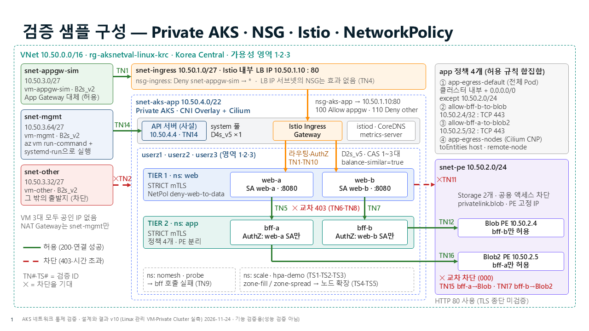</a>

### 01 네트워크 검증 (TN1~TN22)

#### 2. 01 네트워크 검증 (섹션)

<a href="deck/aksnetval-design-v10_render/slide_02.png">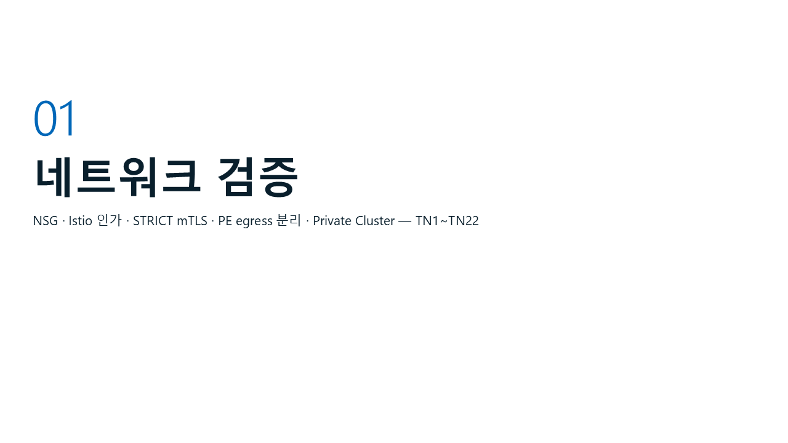</a>

#### 3. 네트워크 검증 매트릭스 — 22건, 차단 테스트마다 허용 대조군

<a href="deck/aksnetval-design-v10_render/slide_03.png">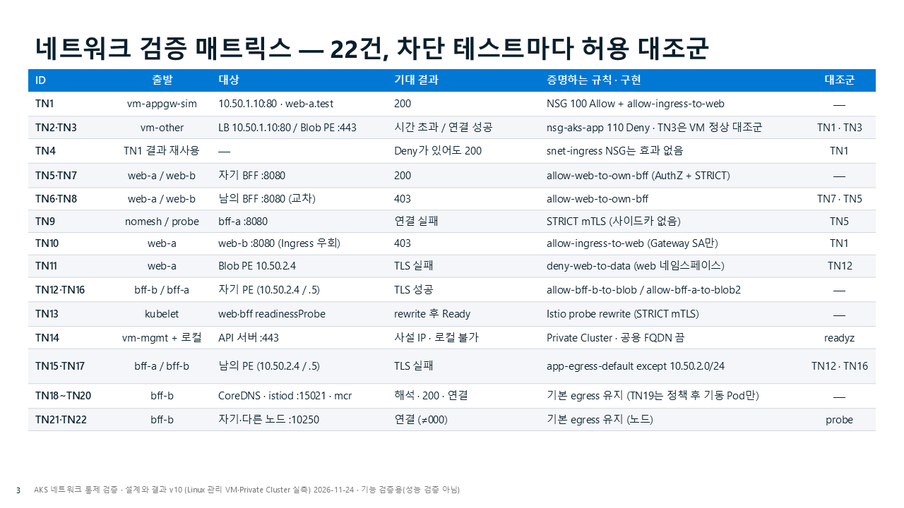</a>

#### 4. 결과 ① 네트워크 통제 — TN1~TN13 13건 모두 PASS

<a href="deck/aksnetval-design-v10_render/slide_04.png">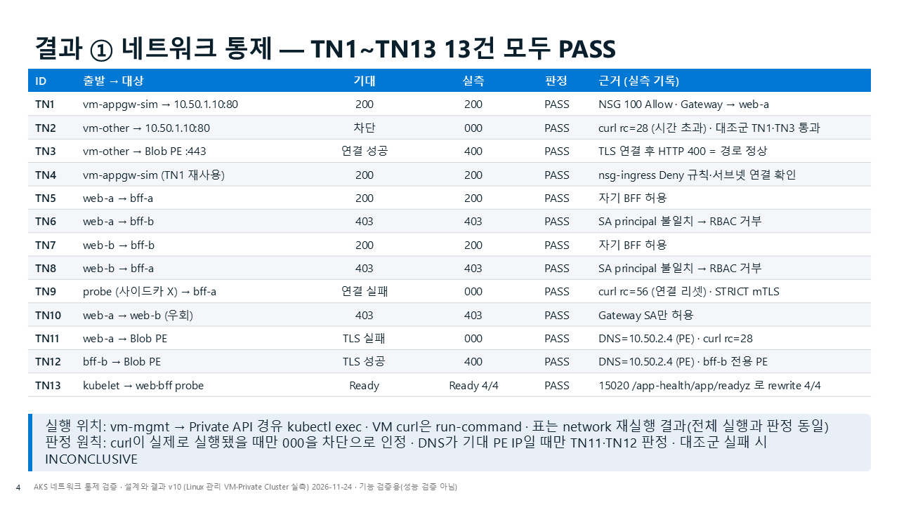</a>

#### 5. PE egress 분리 — bff별 전용 PE만 허용, 기본 egress 유지

<a href="deck/aksnetval-design-v10_render/slide_05.png">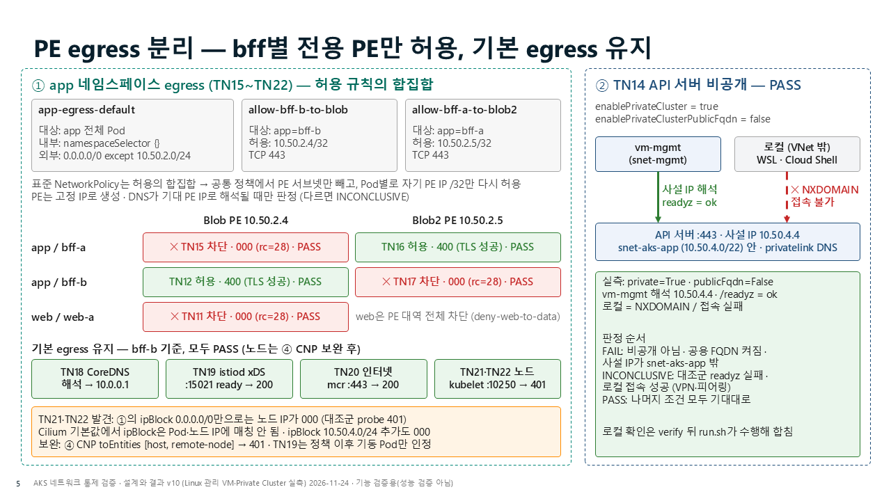</a>

#### 6. 네트워크 결과 정리 — 22 PASS, PRD 시사점과 남은 한계

<a href="deck/aksnetval-design-v10_render/slide_06.png">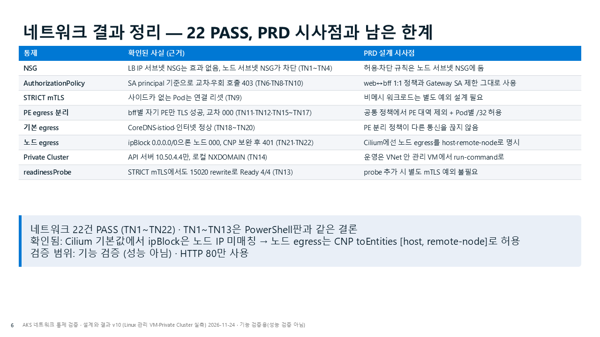</a>

### 02 스케일링 검증 (TS1~TS5)

#### 7. 02 스케일링 검증 (섹션)

<a href="deck/aksnetval-design-v10_render/slide_07.png">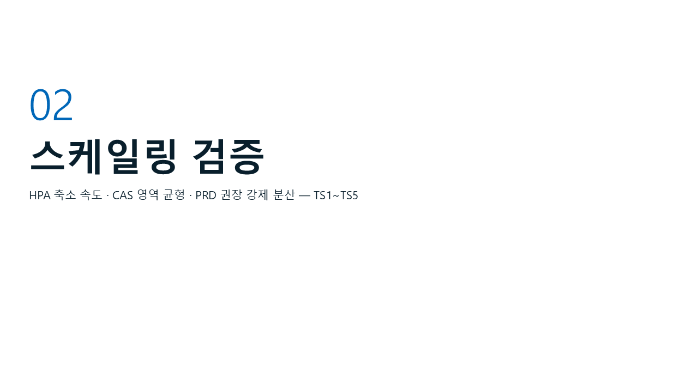</a>

#### 8. 스케일링 검증 매트릭스 — TS1~TS5, 판정 규칙

<a href="deck/aksnetval-design-v10_render/slide_08.png">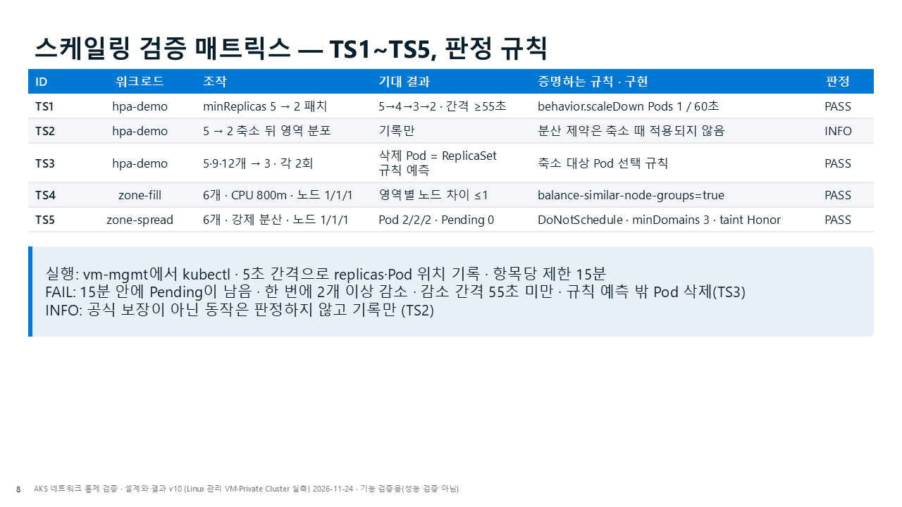</a>

#### 9. 스케일링 검증 — HPA 축소 속도와 영역 균형

<a href="deck/aksnetval-design-v10_render/slide_09.png">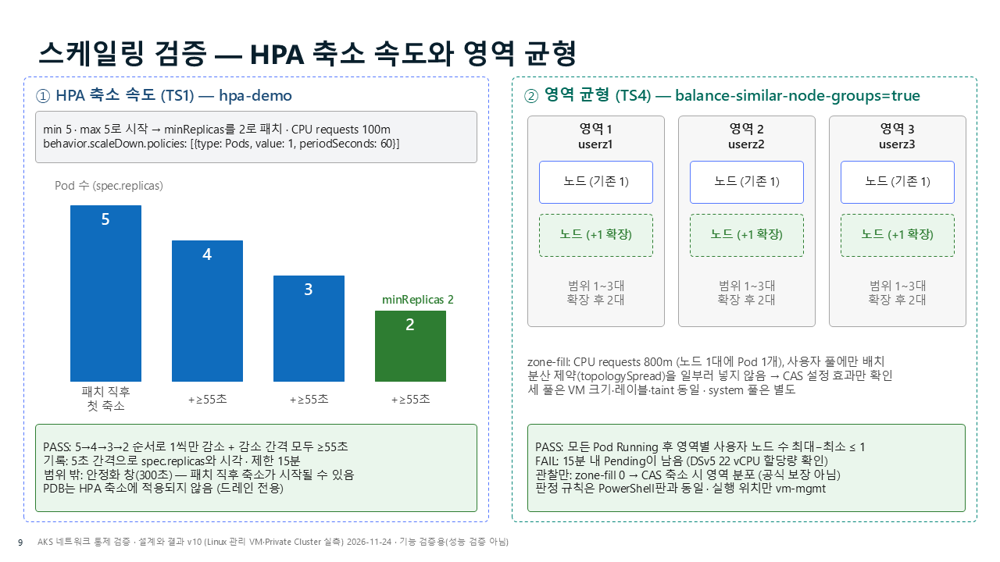</a>

#### 10. 결과 ② 스케일링 — HPA 1분에 1개 축소, 영역 2/2/2 확장

<a href="deck/aksnetval-design-v10_render/slide_10.png">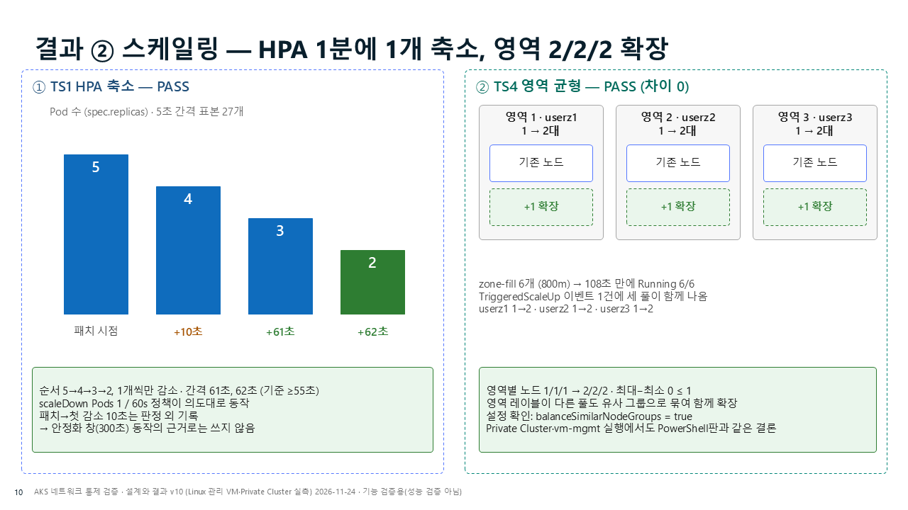</a>

#### 11. 결과 ③ PRD 권장 YAML — 강제 분산 2/2/2, minReplicas 3 축소 1/1/1

<a href="deck/aksnetval-design-v10_render/slide_11.png">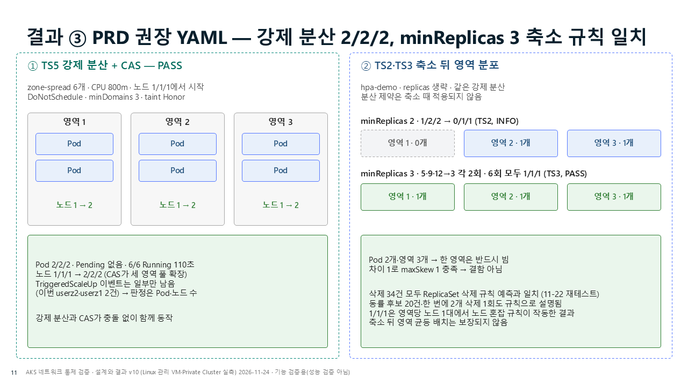</a>

#### 12. 스케일링 결과 정리 — 4 PASS + TS2 INFO, 전체 26 PASS

<a href="deck/aksnetval-design-v10_render/slide_12.png">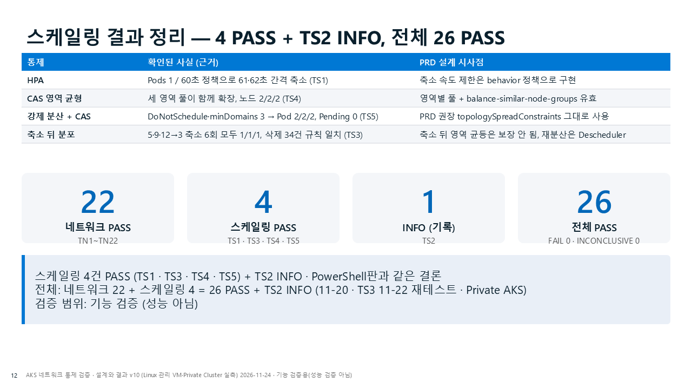</a>

## 검증 구성

```
vnet-aksnetval 10.50.0.0/16 (rg-aksnetval-linux-krc, koreacentral, 영역 1·2·3)
├─ snet-appgw-sim 10.50.3.0/27   VM vm-appgw-sim (Application Gateway 역할, 허용 출발지)
├─ snet-other     10.50.3.32/27  VM vm-other     (차단 대상 출발지)
├─ snet-mgmt      10.50.3.64/27  VM vm-mgmt      (관리 VM, NSG 없음, 전용 NAT Gateway)
├─ snet-ingress   10.50.1.0/27   Istio 내부 Ingress Gateway ILB 10.50.1.10 (nsg-ingress)
├─ snet-aks-app   10.50.4.0/22   AKS 노드 + API 서버 private endpoint 10.50.4.4 (nsg-aks-app)
└─ snet-pe        10.50.2.0/24   Blob PE 10.50.2.4, Blob2 PE 10.50.2.5 (고정 IP)
```

| 항목 | 값 |
|---|---|
| AKS | **Private Cluster**(공용 FQDN 없음), Istio 기반 서비스 메시 애드온(리비전 `asm-1-30`), Azure CNI Overlay + Cilium, v1.36.5 |
| 시스템 풀 | `Standard_D4s_v5` 1대, 영역 1·2·3, `CriticalAddonsOnly` taint. 검증 전용이라 가용성은 없음 |
| 사용자 풀 | `userz1`/`userz2`/`userz3`는 각각 영역 1/2/3, `Standard_D2s_v5`, 오토스케일 1~3 |
| VM | 테스트 VM 2대 + `vm-mgmt`(Ubuntu 22.04), 모두 `Standard_B2s_v2`, 공인 IP 없음 |
| vCPU | DSv5 22 + BSv2 6 = 28 |
| 실행 방식 | 로컬 → `az vm run-command` + `systemd-run`으로 vm-mgmt에서 백그라운드 실행. vm-mgmt의 시스템 할당 관리 ID(RG 범위 Contributor + Network Contributor만 할당 가능한 RBAC 관리자) 사용 |
| 워크로드 | `web` 네임스페이스 `web-a`/`web-b` → `app` 네임스페이스 `bff-a`/`bff-b`(1:1 호출), 사이드카 없는 `nomesh/probe` |

### app 네임스페이스 PE egress 분리(TN15~TN22)

표준 NetworkPolicy는 허용 규칙의 **합집합**입니다. 그래서 공통 정책에서 PE 서브넷만 빼고, Pod별로 필요한 PE IP만 다시 허용합니다.

| 정책 | 대상 Pod | egress 허용 |
|---|---|---|
| `app-egress-default` | app 네임스페이스 전체 | 클러스터 내부(`namespaceSelector: {}`) + `0.0.0.0/0` except `10.50.2.0/24` |
| `allow-bff-b-to-blob` | `app=bff-b` | `10.50.2.4/32` TCP 443 |
| `allow-bff-a-to-blob2` | `app=bff-a` | `10.50.2.5/32` TCP 443 |
| `app-egress-nodes`(CiliumNetworkPolicy) | app 네임스페이스 전체 | `toEntities: [host, remote-node]`(노드 IP) |

### 노드 egress(TN21·TN22)

AKS Azure CNI powered by Cilium은 기본 설정(`policy-cidr-match-mode` 미설정)에서 표준 NetworkPolicy의 `ipBlock`을 Pod·노드 IP에 매칭하지 않습니다([Cilium 문서](https://docs.cilium.io/en/stable/network/kubernetes/policy/)). 그래서 `0.0.0.0/0`을 허용해도 노드 IP(kubelet, hostNetwork Pod, NodePort 등)로 가는 연결이 막힙니다. 처음 실행([`03-node-egress-fail`](evidence/linux/03-node-egress-fail_20261120-075659.md))에서 TN21·TN22가 FAIL이었고, vm-mgmt에서 정책을 바꿔 가며 확인한 결과는 다음과 같습니다.

| 조건 | bff-b → 노드 :10250 | 대조군 nomesh/probe |
|---|---|---|
| NetworkPolicy 3개만 | 000(차단) | 401 |
| + NetworkPolicy ipBlock `10.50.4.0/24` | 000(차단) | 401 |
| + CiliumNetworkPolicy `toEntities: [host, remote-node]` | 401(연결) | 401 |

401은 kubelet이 인증을 요구한 응답이라 TCP·TLS 연결이 성공했다는 뜻입니다. 이 CNP를 `31-app-pe-egress.yaml`에 넣고 다시 실행해 TN21·TN22 PASS를 확인했습니다. CNP는 PE IP를 열지 않으므로 TN15·TN17 차단은 그대로입니다.

## 테스트 매트릭스와 실측 결과

네트워크 항목(TN1~TN22)은 `app-egress-nodes`를 추가한 뒤 새 클러스터에서 `--only network`로 실행한 [`evidence/linux/04-node-egress-fix_20261120-082121.md`](evidence/linux/04-node-egress-fix_20261120-082121.md), 스케일 항목(TS1·TS2·TS4·TS5)은 전체 실행 [`evidence/linux/01-full-run_20261120-050457.md`](evidence/linux/01-full-run_20261120-050457.md), TS3은 코드 리뷰 수정 후 새 클러스터에서 `--only floor`로 다시 실행한 [`evidence/linux/06-ts3-rules_20261122-114525.md`](evidence/linux/06-ts3-rules_20261122-114525.md)(2026-11-22) 결과입니다. 이번 변경은 app 네임스페이스 egress 정책만 다루므로 스케일 항목은 다시 실행하지 않았습니다.

| ID | 출발 → 대상 | 검증 통제 | 기대 | 실측 | 판정 |
|---|---|---|---|---|---|
| TN1 | vm-appgw-sim → 10.50.1.10:80 | NSG 허용, Gateway → web-a | 200 | 200 | PASS |
| TN2 | vm-other → 10.50.1.10:80 | NSG 차단 | 차단(000) | 000, curl rc=28(시간 초과) | PASS |
| TN3 | vm-other → Blob :443 | TN2 대조군(VM 자체 통신 정상) | 연결 성공 | 400(TLS 연결 성공) | PASS |
| TN4 | vm-appgw-sim(TN1 재사용) | snet-ingress NSG에 Deny가 있어도 효과 없음 | 200 | 200 | PASS |
| TN5 | web-a → bff-a | AuthZ 허용(자기 BFF) | 200 | 200 | PASS |
| TN6 | web-a → bff-b | AuthZ 거부(SA principal 불일치) | 403 | 403 | PASS |
| TN7 | web-b → bff-b | AuthZ 허용 | 200 | 200 | PASS |
| TN8 | web-b → bff-a | AuthZ 거부 | 403 | 403 | PASS |
| TN9 | nomesh/probe → bff-a | STRICT mTLS | 연결 실패 | 000, curl rc=56(연결 리셋) | PASS |
| TN10 | web-a → web-b(Gateway 우회) | AuthZ: Gateway SA만 허용 | 403 | 403 | PASS |
| TN11 | web-a → Blob PE | web 네임스페이스 NetworkPolicy로 Tier 3 차단 | TLS 실패 | 000, DNS=10.50.2.4, rc=28 | PASS |
| TN12 | bff-b → Blob PE(10.50.2.4) | bff-b 전용 PE 허용 | TLS 성공 | 400, DNS=10.50.2.4 | PASS |
| TN15 | bff-a → Blob PE(10.50.2.4) | 다른 Pod의 PE는 차단(대조군 TN12) | TLS 실패 | 000, DNS=10.50.2.4, rc=28 | PASS |
| TN16 | bff-a → Blob2 PE(10.50.2.5) | bff-a 전용 PE 허용 | TLS 성공 | 400, DNS=10.50.2.5 | PASS |
| TN17 | bff-b → Blob2 PE(10.50.2.5) | 다른 Pod의 PE는 차단(대조군 TN16) | TLS 실패 | 000, DNS=10.50.2.5, rc=28 | PASS |
| TN18 | bff-b → CoreDNS | 기본 egress 유지(DNS) | 해석 성공 | 10.0.0.1 | PASS |
| TN19 | bff-b → 15021 ready | 기본 egress 유지(istiod xDS) | 200, 정책 이후 기동한 Pod | 200 | PASS |
| TN20 | bff-b → mcr.microsoft.com:443 | 기본 egress 유지(인터넷) | 연결 성공 | 200 | PASS |
| TN21 | bff-b → 자기 노드 :10250(kubelet) | 기본 egress 유지(노드) | 연결 성공(≠000) | 401, 대조군 probe 401 | PASS |
| TN22 | bff-b → 다른 노드 :10250(kubelet) | 기본 egress 유지(노드) | 연결 성공(≠000) | 401, 대조군 probe 401 | PASS |
| TS1 | HPA minReplicas 5 → 2 | scaleDown Pods 1 / 60s | 5→4→3→2, 간격 55초 이상 | 5,4,3,2, 간격 61초·62초 | PASS |
| TS2 | TS1 축소 전·후 `hpa-demo` 분포 | 2개로 줄인 뒤 분포 기록 | 기록(판정 없음) | 1/2/2 → 0/1/1 | INFO |
| TS3 | `hpa-demo` 5·9·12개 → minReplicas 3, 각 2회 | 축소 대상 Pod 선택(ReplicaSet 삭제 규칙) | 지워진 Pod = 규칙 예측 | 2/2/1·3/3/3·4/4/4 → 6회 모두 1/1/1, 삭제 34건 모두 예측과 일치(후보 2개 이상 20건, Ready 동률 비이행 비교 5건, 한 번에 2개 삭제 1회) | PASS |
| TS4 | `zone-fill` 6개 | CAS 영역 균형 | 영역별 노드 차이 1 이하 | 1/1/1 → 2/2/2, 108초 만에 6개 모두 Running | PASS |
| TS5 | `zone-spread` 6개(DoNotSchedule, minDomains 3) | 강제 분산 + CAS | Pod 2/2/2, Pending 없음 | Pod 2/2/2, 노드 1/1/1 → 2/2/2, 110초 | PASS |
| TN13 | kubelet → web·bff readinessProbe | Istio probe rewrite(STRICT mTLS) | rewrite 후 Ready | Ready 4/4, `15020 /app-health/app/readyz` 4/4 | PASS |
| TN14 | vm-mgmt + 로컬 → API 서버 :443 | Private Cluster | 사설 IP로만 해석·접근, 로컬 접근 불가 | private=True, publicFqdn=False, vm=10.50.4.4, readyz=ok, 로컬 NXDOMAIN | PASS |

TS4의 근거는 TriggeredScaleUp 이벤트 1건입니다. 한 번의 확장에서 `userz1/2/3 1->2`가 함께 일어났습니다. 이벤트는 Pod별로 중복 제거되어 일부만 보일 수 있으므로 TS5는 Pod·노드 수로만 판정합니다.

TS2의 0/1/1은 Pod 2개를 세 영역에 둔 결과라 한 영역이 비는 것이 당연하고, 차이 1은 `maxSkew: 1`도 만족합니다. 그래서 기록만 합니다.

TS3의 1/1/1은 영역마다 노드가 1대이고 HPA가 1분에 1개씩 줄여, 매번 "같은 노드에 Pod가 많은 쪽부터" 규칙이 다시 적용된 결과입니다. 같은 노드 혼잡도에서는 Ready 시각의 log2 구간(같으면 UID 순)으로 갈렸습니다. 판정은 Pod 감시(`kubectl get -w`)로 기록한 삭제 요청 시각과 Pod 이름으로 했습니다. `SuccessfulDelete` 이벤트는 비슷한 이벤트가 합쳐지며 메시지가 덮어써져 9개 이상 축소에서는 쓸 수 없었습니다.

### 판정 원칙

- 판정은 `PASS`, `FAIL`, `INCONCLUSIVE` 세 가지이고, 관찰만 하는 TS2는 `INFO`입니다.
- 대조군(TN1, TN3, TN5, TN7, TN12, TN16)이 실패하면 해당 차단 테스트는 `INCONCLUSIVE`입니다.
- 차단 기대(000)는 curl이 실제로 실행됐을 때만 인정합니다. exec나 run-command가 실패했거나 `rc=126/127`이면 `INCONCLUSIVE`입니다.
- TN11·TN12·TN15~TN17은 Blob FQDN이 기대한 PE 고정 IP로 해석될 때만 판정합니다. 다르면 `INCONCLUSIVE`입니다.
- TN19는 bff-b Pod가 NetworkPolicy 생성 이후 기동했을 때만 근거로 인정합니다. 타임스탬프가 초 단위라 `02-apply.sh`는 정책 적용 후 다음 초로 넘긴 뒤 app을 재시작합니다.
- TN21·TN22는 대조군(정책 없는 `nomesh/probe`에서 같은 노드로 접속)이 연결에 실패하거나 실행되지 않으면 `INCONCLUSIVE`입니다.
- 검증 함수가 중간에 중단되면 그 함수가 맡은 나머지 Id마다 `INCONCLUSIVE` 행을 남깁니다. 요약에서 누락된 테스트가 PASS처럼 보이지 않게 하기 위해서입니다.
- TS3은 지워진 Pod 중 하나라도 ReplicaSet 삭제 규칙 예측(삭제 시각 −3~+1초 범위, 같은 순위 동률 포함)에 없으면 FAIL, 삭제 기록이나 축소 전 스냅샷이 없으면 `INCONCLUSIVE`입니다. 2초 안의 삭제는 한 번의 동기화로 보고 한 번 정렬해 앞에서부터 고릅니다. Ready·생성 시각이 같은 Pod는 완전 동률이 되어 비교가 비이행적일 수 있으므로, 1개 삭제에서는 정렬 입력 순서에 따라 맨 앞에 올 수 있는 Pod를 모두 후보로 인정합니다. Pod 12개 이하는 Go가 삽입 정렬을 쓰므로, 동률이 사슬처럼 이어져 앞의 Pod를 막는 경우까지 삽입 정렬을 모의해 판단합니다. 2개 이상 삭제는 동률 순서를 바꿔 설명되면 인정하고, 삭제 기록 일부가 없으면 `INCONCLUSIVE`입니다.
- TS4는 Pending Pod가 남으면 FAIL입니다. 노드가 늘지 않았거나 시작 상태(풀마다 1대)를 만들지 못하면 `INCONCLUSIVE`입니다.
- TS5는 노드 1/1/1에서 시작해 15분 안에 Pending 없이 영역별 Pod 수 차이가 1 이하면 PASS, Pending이 남으면 FAIL입니다.
- TN13은 probe 없음, rewrite 안 됨, Not Ready 중 하나라도 있으면 FAIL입니다.
- TN14는 Private 설정이 아니거나, 공용 FQDN이 켜져 있거나, vm-mgmt의 해석 IP가 `snet-aks-app` 밖이면 FAIL입니다. 로컬이 VPN·피어링으로 VNet에 닿아 접속에 성공하면 `INCONCLUSIVE`입니다.

## 확인된 사실과 PRD 시사점

| 통제 | 확인된 사실 | 설계 시사점 |
|---|---|---|
| NSG | ILB가 있는 서브넷의 NSG는 효과가 없고, 노드 서브넷 NSG가 차단(TN1~TN4) | 허용·차단 규칙은 노드 서브넷 NSG에 둠 |
| AuthorizationPolicy | SA principal 기준으로 교차 호출과 우회 호출이 403(TN6·TN8·TN10) | web↔bff 1:1 정책과 Gateway SA 제한을 그대로 사용 |
| STRICT mTLS | 사이드카 없는 Pod는 연결이 리셋됨(TN9) | 메시 밖 워크로드는 별도 예외 설계 필요 |
| NetworkPolicy(web) | 사이드카를 거쳐도 PE 대역이 차단됨(TN11) | Tier 3 데이터 분리에 NetworkPolicy가 유효 |
| NetworkPolicy(app, Pod별 PE) | 공통 정책에서 PE 서브넷을 빼고 Pod별 PE IP만 허용하면, 자기 PE만 연결되고 다른 Pod의 PE는 차단(TN12·TN15~TN17). DNS, istiod, 인터넷 egress는 유지(TN18~TN20) | 같은 네임스페이스 안에서도 Pod 단위로 데이터 저장소 접근을 나눌 수 있음. PE는 고정 IP로 만들어 정책 IP와 일치시킴 |
| 노드 egress(Cilium) | `ipBlock 0.0.0.0/0`만으로는 노드 IP가 000, CNP `toEntities: [host, remote-node]` 추가 후 401(TN21·TN22) | egress를 제한하는 네임스페이스에는 노드 egress를 CNP로 명시 |
| Private Cluster | API 서버는 사설 IP 10.50.4.4로만 해석·접근, 로컬은 NXDOMAIN(TN14). 관리 VM에서 생성·적용·검증 전 과정이 동작 | 운영 작업은 VNet 안 관리 VM(또는 동급 경로)에서 수행. 관리 ID는 RG 범위 + 조건부 RBAC 관리자로 제한 가능 |
| HPA | Pods 1 / 60초 정책으로 약 60초 간격으로 축소(TS1) | 축소 속도 제한은 `behavior` 정책으로 구현 |
| CAS 영역 균형 | 영역 레이블이 다른 풀도 유사 그룹으로 묶여 함께 확장, 1/1/1 → 2/2/2(TS4) | 영역별 풀 + `balance-similar-node-groups` 조합이 유효 |
| 강제 분산 + CAS | `DoNotSchedule`·`minDomains: 3`에서 Pending Pod를 보고 CAS가 세 영역을 확장, Pod 2/2/2(TS5) | PRD 권장 `topologySpreadConstraints`를 그대로 사용 가능 |
| 축소 대상 Pod | 5·9·12 → 3 축소 6회 모두 1/1/1, 삭제 34건 모두 ReplicaSet 규칙 예측과 일치(TS3) | 분산 제약은 축소 때 적용되지 않으므로 축소 뒤 영역 균등은 보장되지 않음. 필요하면 Descheduler로 재분산 |
| readinessProbe | STRICT mTLS에서도 `15020 /app-health/...` rewrite로 Ready(TN13) | probe를 추가해도 별도 mTLS 예외 불필요 |

## 한계

- 기능 검증이며 성능 검증은 아닙니다. HTTP 80만 사용했고 TLS 종단은 검증하지 않았습니다.
- 노드 egress는 kubelet `:10250` 연결만 확인했습니다. `app-egress-nodes`는 노드의 모든 포트를 엽니다.
- TS1은 축소 속도 정책만 검증합니다. 안정화 창(300초)은 검증하지 않습니다.
- TS4는 확장만 판정하고 축소는 관찰만 합니다. 영역별 정확한 노드 수는 기존 Pod 배치에 따라 달라질 수 있습니다.
- TN13은 rewrite된 probe로 Ready가 되는 것만 확인합니다. 앱이 실패할 때 NotReady로 바뀌는 음성 시나리오는 검증하지 않습니다.
- TS3의 1/1/1은 영역당 노드 1대·1개씩 축소 조건의 결과입니다. 영역에 노드가 여러 대이거나 한 번에 여러 개를 줄이면(한 번 정렬 후 노드별 개수를 다시 세지 않음) 1/0/2처럼 한 영역이 빌 수 있습니다. 이번 실행에서는 한 번에 2개 삭제가 1회 있었습니다.
- TN14의 로컬 측 근거는 실행한 로컬 환경(사내망, VNet 미연결)에서의 결과입니다.
- 시스템 노드 1대와 Gateway 기본 배치는 검증용 구성입니다. PRD에서는 Gateway 전용 `ingress` 풀을 권장합니다.
- 공개 저장소라 로그의 로컬 경로는 `<repo>`, Storage 계정 이름은 `staksnetval<hash>`, 구독 이름은 `<subscription>`, API 서버 사설 FQDN은 `<cluster>.<guid>.privatelink…`로 마스킹했습니다.

## 재현

WSL 또는 Cloud Shell의 bash, Azure CLI, Python 3가 필요합니다. 자세한 내용과 문제 해결은 [`aks-network-validation-linux/README.md`](aks-network-validation-linux/README.md)를 보세요.

```bash
cd aks-network-validation-linux
python3 -m pytest -q               # 단위 테스트 214개 통과, 1개 skip
local/00-bootstrap.sh --force      # 사전 점검, vm-mgmt 준비, 약 5분
local/run.sh infra                 # 약 25분
local/run.sh apply                 # 약 5분
local/run.sh verify                # TN1~TN22·TS1~TS5, 약 40분 (--only network|hpa|floor|zone|spread)
local/99-cleanup.sh --force        # 리소스 그룹 삭제
```

## 이전 판: PowerShell판

로컬 Windows PowerShell에서 **공개 API 서버** 클러스터를 대상으로 TN1~TN13·TS1~TS5를 실행한 첫 판입니다. **결과: 17건 PASS + TS2 INFO**(2026-11-20, koreacentral). Linux판과 결론이 같습니다. TN14~TN22는 이 판에 없습니다.

스크립트는 Linux판으로 합치면서 삭제했습니다. 공통 매니페스트는 [`aks-network-validation-linux/manifests/`](aks-network-validation-linux/manifests/)로 옮겼습니다. 삭제 직전 스크립트는 커밋 [`0104237`](https://github.com/freeman9844/aks-istio-network-test-01/tree/0104237/aks-network-validation)에서 볼 수 있습니다.

- 결과: [`evidence/10-v4-full-run_20261120-100357.md`](evidence/10-v4-full-run_20261120-100357.md), TS3 재실행 [`evidence/11-v4-ts3-rerun_20261120-100846.md`](evidence/11-v4-ts3-rerun_20261120-100846.md), 이전 실행 이력은 [증적 색인](evidence/README.md)
- 장표: [`deck/aksnetval-design-v4.pptx`](deck/aksnetval-design-v4.pptx)(7장)
